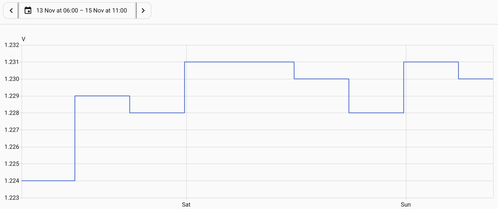

Ja.

2024 habe ich beschlossen, meine eigenen Matter-Geräte zu bauen, um mein Smart Home um Funktionen zu erweitern, die es von den Herstellern nicht gab. Mich hat die langsame Verbreitung des Standards genervt, von dem ich dachte, dass er der bessere ist. Er sollte schließlich von offiziellen Systemen wie Google Home und Apple Home unterstützt werden, im Gegensatz zu vielen Bastler- oder altmodischen Systemen auf Zigbee- oder KNX-Basis.

Ich hatte absolut keine Ahnung, wo ich anfangen sollte, aber ich bin auf die [Matter-Arduino-Bibliothek von SiliconLabs](https://github.com/SiliconLabsSoftware/arduino/) gestoßen und dachte mir: Arduino ist ein toller Einstieg! Ich habe mir das [MGM240P](https://www.sparkfun.com/sparkfun-thing-plus-matter-mgm240p.html) gekauft, dazu ein paar Sensoren, und hab losgelegt. Dank eines [Freundes](https://dazgupta.com) lief innerhalb von ein paar Tagen schon was, und ich dachte: das ist ja einfach! Das schaff ich! Es gab nur einen Haken: ich habe rund 30 Euro für das Board ausgegeben und wollte mehr davon bauen, dafür musste es aber billiger werden. Das Dev-Board war also raus.

Bei meiner Recherche bin ich dann auf eine damals noch recht neue Bibliothek gestoßen, die [Matter-Support für embedded Rust](https://github.com/project-chip/rs-matter) bringt. Mit Rust hatte ich schon ein paar Jahre Erfahrung und fühlte mich damit deutlich wohler als mit Arduino oder großen C++-SDKs wie der offiziellen Matter-Bibliothek. Mit Support aus der Community (hauptsächlich [ivmarkovs Embassy-Projekt](https://github.com/sysgrok/rs-matter-embassy)) ging es voran. Langsam aber stetig hat er mir geholfen, mein Projekt zum Laufen zu bringen und nebenbei die Bibliothek zu verbessern. Wir haben zusammen [Probleme mit dem ESP32-H2 debuggt](https://github.com/sysgrok/rs-matter-embassy/issues/13), [besseren Sleepy-End-Device-Support eingebaut](https://github.com/sysgrok/rs-matter-embassy/issues/84) und am Ende mein ursprüngliches Ziel erreicht.

Ich habe jetzt einen [batteriebetriebenen Bodenfeuchtesensor](https://www.seeedstudio.com/XIAO-Soil-Sensor-p-6452.html) in meinem Büro stehen, der ~9 Euro gekostet hat. Das Gerät sollte 1–2 Jahre mit einer einzigen AA-Zelle durchhalten und alle 6 Stunden einen Messwert liefern.

Das Projekt ist dem von [automatous-io/xiao-soil-moisture-sensor-matter-thread](https://github.com/automatous-io/xiao-soil-moisture-sensor-matter-thread) sehr ähnlich und ich habe den Kalibrierungs- und Spannungsmessungs-Code von dort als Ausgangspunkt genommen. Ich glaube, wir sind beide etwa zur gleichen Zeit darauf gekommen, dass der XIAO Soil Moisture Sensor ein super Gerät für einen Matter-Port ist, wegen des Thread-fähigen MCUs auf dem Board.

## Der Überblick

**Gerät:** [Seeed XIAO Soil Moisture Sensor Kit](https://www.seeedstudio.com/XIAO-Soil-Sensor-p-6452.html) — kapazitive Bodenfeuchtesonde, drei Status-LEDs, ein Button und ein AA-Batteriehalter auf einem XIAO-ESP32-C6-Träger (4 MB Flash, externe U.FL-Antenne). ~9 EUR pro Stück.

**MCU:** ESP32-C6 (32-Bit-RISC-V, läuft mit esp-hals Standard-Preset auf 80 MHz) mit integriertem 802.15.4-Funkmodul für Thread und BLE.

**Sensoren / Eingänge:**
- Kapazitive Bodenfeuchtesonde, über ADC an GPIO1 gelesen, mit Erreger-PWM an GPIO21
- Batteriespannung über ADC an GPIO0 (eine AA-Zelle hinter einem TPS61021A-Aufwärtswandler auf 3V3)
- User-Button an GPIO2 (active low)
- Drei Status-LEDs an GPIO18/19/20 (gelb/grün/rot)

**Wichtige Bibliotheken:**
- [rs-matter](https://github.com/project-chip/rs-matter)
- [rs-matter-embassy](https://github.com/sysgrok/rs-matter-embassy)
- [esp-hal](https://github.com/esp-rs/esp-hal)
- [esp-radio](https://github.com/esp-rs/esp-radio) (802.15.4 Thread + BLE-Support)

## Was ich gelernt habe

- **Matter-Grundlagen: Commissioning über BLE.** Das Gerät joined dem Fabric über BLE, während Thread parallel hochfährt, und danach läuft alles über Thread/IPv6. Wegen der Test-Credentials (VID `0xFFF1`, PID `0x8010`) zeigt jedes Ökosystem eine „uncertified device"-Warnung. Fabrics liegen persistent im Flash (`sequential-storage`), deshalb kommt selbst ein Deep-Sleep-Neustart als dasselbe commissionierte Gerät zurück.

- **Thread-Grundlagen: welche Probleme wir hatten und wie wir sie debuggt haben.** Zuerst der ESP32-H2, zusammen mit ivmarkov ([#13](https://github.com/sysgrok/rs-matter-embassy/issues/13)); dann auf dem C6: BLE-Advertisements gingen im Concurrent-Commissioning-Modus nie on air ([#82](https://github.com/sysgrok/rs-matter-embassy/issues/82)). Hat sich rausgestellt: BLE und Thread teilen sich das Funkmodul, und BLE muss dazwischen sauber runtergefahren werden — dafür brauchte es Power-Domain-Arbeit in esp-radio/esp-hal ([esp-hal#6406](https://github.com/esp-rs/esp-hal/pull/6406)). SED-Support brauchte obendrauf OpenThread-Patches ([openthread#121](https://github.com/esp-rs/openthread/pull/121), [#122](https://github.com/esp-rs/openthread/pull/122)). Debuggt haben wir das mit defmt-Logs über USB plus einem Sniffer. Der lustigste Bug: die Logs in [#84](https://github.com/sysgrok/rs-matter-embassy/issues/84) zeigen, dass der Check-In rausging, bevor Thread und der SRP-Lookup überhaupt oben waren und genau deshalb war das in Home Assistant so racy.

- **Protokoll: SED, SIT vs LIT.** Ein Sleepy End Device sagt seinem Parent im Grunde „ich schlaf, puffer meine Daten" und pollt danach. SIT (Idle ≤ 15 s) ist für Dinge, die schnell reagieren sollen; LIT (Idle von Minuten) ist für Sensoren wie diesen hier, bei denen der Controller Check-Ins abonniert. Aber LIT schläft nur wirklich tief, wenn der Controller mitspielt (Google/Apple hatten es noch nicht, Samsung war Beta-only, Home Assistant hatte einen Bug), sonst fällt das Gerät heimlich auf SIT zurück und verbrennt Batterie.

- **MCU: Deep Sleep vs Light Sleep.** Auf dem C6 ist Deep Sleep ein kompletter Reboot (nur ein Timer bleibt wach), deshalb muss alles im Flash liegen. Gemessen ~0,12 mA an der Zelle auf diesem Board (der Chip allein liegt bei ~7 µA; der Boost-Wandler frisst wohl den Rest). Light Sleep behält den RAM, kostet aber 35–180 µA, was für ein LIT-Gerät einfach das falsche Werkzeug ist. Und wach zieht das Board ~100 mA an der Zelle, jede Millisekunde Wachzeit ist also ~25x so viel wert wie eine Millisekunde Schlaf.

Und so sieht das auf einer echten Zelle aus: Spannung einer einzelnen AA über mehrere Tage bei 900-s-Schlafzyklen und 5 s aktivem Poll (die Tag/Nacht-Zyklen sieht man klar, die Spitzen sind USB-C-Flashen):

 und Nacht- (steiler) Zyklen sichtbar, Spitzen sind USB-C-Flashen")

Als es dann auf das 6-h-LIT-Intervall eingependelt war, sah die gemeldete Spannung in Home Assistant so aus: flache Stufen, kaum Bewegung pro Tag, daher die Schätzung von über 1 Jahr:

Etwas Neues aufzusetzen ist jetzt trivial: `rustup`, `espup`, `espflash`, ein `cargo run` baut und flasht — kein IDE, kein SDK-Installer.

## Was als Nächstes kommt

- Irgendwann würde ich gern OTA-Updates einbauen, aber ich bin mir nicht sicher, ob ich das wirklich durchziehe. Dafür braucht es noch etwas mehr Gedanken um genug Speicherplatz und so. Aber im Moment ist es gut genug, und ich bin froh, dass ich es in einen funktionierenden Zustand gebracht habe.

- Beobachten, wohin sich das Ökosystem entwickelt, und ob in den kommenden Monaten alle großen Plattformen SED-LIT-Geräte unterstützen, damit das auch auf anderen Plattformen nutzbarer wird.

- Mir ein neues Gerät ausdenken. Jetzt, wo der Großteil der Setup-Arbeit erledigt ist, geht es ja nur noch darum, eine neue Gerätekategorie zu finden. Vielleicht ein mmWave-Präsenzsensor?
