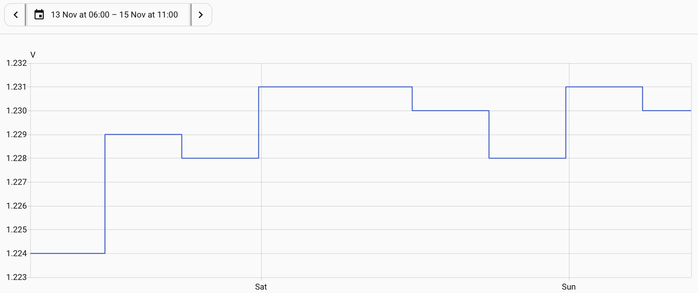

Yes.

In 2024, I decided to build my own Matter devices to extend my smart home with functionality that I could not get from hardware vendors. I was annoyed by the slow adoption of what I thought was the better smart home standard. It was meant to get support from official systems like Google Home and Apple Home, unlike many of the hobbyist or old-school systems based on Zigbee or KNX.

I had absolutely no idea where I should start, but I found the [Matter Arduino library from SiliconLabs](https://github.com/SiliconLabsSoftware/arduino/) and thought Arduino is a great start! I bought the [MGM240P](https://www.sparkfun.com/sparkfun-thing-plus-matter-mgm240p.html) and some sensors for it and got started. Thanks to an amazing [friend of mine](https://dazgupta.com) I was able to get something working within a few days and thought this is easy! I can do this! There was just one caveat: I spent roughly 30 Euros on the device and wanted to make more of these, and for that it had to be cheaper. The dev board I bought was just not going to work.

After a bit of research I stumbled across a fairly new library at the time to [bring Matter support to embedded Rust](https://github.com/project-chip/rs-matter). I had already a few years under my belt with Rust and I felt way more comfortable with it than with Arduino or large C++ SDKs like the official matter-library. With some amazing support from the community (mostly [ivmarkov's embassy project](https://github.com/sysgrok/rs-matter-embassy)) I made progress. Slowly but steadily he helped me bring my project alive, and improve the library while we're at it. We [debugged issues with ESP32-H2](https://github.com/sysgrok/rs-matter-embassy/issues/13) together, [introduced better Sleepy End-Device support](https://github.com/sysgrok/rs-matter-embassy/issues/84) and in the end made my original goal a reality.

I now have a [battery powered soil moisture sensor](https://www.seeedstudio.com/XIAO-Soil-Sensor-p-6452.html) in my office which cost ~9 Euros per piece. The device should last between 1–2 years on a single AA cell and provide a reading every 6 hours.

The project is very similar to [automatous-io/xiao-soil-moisture-sensor-matter-thread](https://github.com/automatous-io/xiao-soil-moisture-sensor-matter-thread), I took the calibration and voltage reading code from the project as a starting point. I think we both discovered around the same time that the XIAO Soil Moisture Sensor is a great device to port to Matter due to the Thread-supporting MCU on the board.

## The Overview

Device: [Seeed XIAO Soil Moisture Sensor kit](https://www.seeedstudio.com/XIAO-Soil-Sensor-p-6452.html) — a capacitive soil probe, three status LEDs, a button and an AA battery holder on a XIAO ESP32-C6 carrier (4 MB flash, external U.FL antenna). ~9 EUR per piece.

MCU: ESP32-C6 (32-bit RISC-V, runs at esp-hal's default 80 MHz preset) with an integrated 802.15.4 radio used for both Thread and BLE.

Sensors / inputs:
- Capacitive soil moisture probe, read via ADC on GPIO1 with excitation PWM on GPIO21
- Battery voltage via ADC on GPIO0 (single AA cell behind a TPS61021A boost converter to 3V3)
- User button on GPIO2 (active low)
- Three status LEDs on GPIO18/19/20 (yellow/green/red)

Crucial Libraries:
- [rs-matter](https://github.com/project-chip/rs-matter)
- [rs-matter-embassy](https://github.com/sysgrok/rs-matter-embassy)
- [esp-hal](https://github.com/esp-rs/esp-hal)
- [esp-radio](https://github.com/esp-rs/esp-radio) (802.15.4 Thread + BLE support)

## What I learned

- **Matter basics: commissioning via BLE.** The device joins the fabric over BLE while Thread comes up in parallel, and from then on everything rides on Thread/IPv6. Because I use the test credentials (VID `0xFFF1`, PID `0x8010`), every ecosystem shows an "uncertified device" warning — expected, just ignore it. Fabrics are persisted in flash (`sequential-storage`), so even a deep-sleep boot comes back as the same commissioned device.

- **Thread basics: the issues we hit and how we debugged them.** First the ESP32-H2, together with ivmarkov ([#13](https://github.com/sysgrok/rs-matter-embassy/issues/13)); then on the C6: BLE advertisements never went on air in concurrent commissioning mode ([#82](https://github.com/sysgrok/rs-matter-embassy/issues/82)). Turned out BLE and Thread share the radio, and BLE has to be powered down properly in between — that needed power-domain work in esp-radio/esp-hal ([esp-hal#6406](https://github.com/esp-rs/esp-hal/pull/6406)). SED support needed OpenThread patches on top ([openthread#121](https://github.com/esp-rs/openthread/pull/121), [#122](https://github.com/esp-rs/openthread/pull/122)). We debugged with defmt logs over USB plus a sniffer. The logs in [#84](https://github.com/sysgrok/rs-matter-embassy/issues/84) show the Check-In being sent before Thread and the SRP lookup were even up — which is exactly why it behaved so racy in Home Assistant.

- **Protocol: SED, SIT vs LIT.** A Sleepy End Device basically tells its parent "I'm asleep, buffer my stuff" and polls for it. SIT (idle ≤ 15 s) is for things that should react fast; LIT (idle of minutes) is for sensors like this one, where the controller subscribes to Check-Ins. But LIT only really deep-sleeps if the controller plays along (Google/Apple didn't support it yet, Samsung was beta-only, Home Assistant had a bug), otherwise the device silently falls back to SIT and burns battery.

- **MCU: deep sleep vs light sleep.** On the C6, deep sleep is a full reboot — only a timer stays powered, so everything has to live in flash. Measured ~0.12 mA at the cell on this board (the chip alone is ~7 µA; the boost converter probably eats the rest). Light sleep keeps RAM but costs 35–180 µA, which is simply the wrong tool for a LIT device. And while awake the board pulls ~100 mA at the cell, so every millisecond of awake time is worth ~25x a millisecond of sleep.

And here's what that actually looks like on a real cell: this is the voltage of a single AA over several days at 900 s sleep cycles with a 5 s active poll (you can see the day/night cycles; the spikes are me flashing over USB-C):

 and night (steeper) cycles visible, spikes are USB-C flashing")

Once it settled on the 6 h LIT interval, the reported voltage in Home Assistant looked like this: flat steps, barely any movement per day, which is where the >1 year estimate comes from:

## What's next

- At some point I would like to add OTA updates, but I am not sure if I will actually push that. It will require some more grease around having enough storage and things. And right now it is good enough, and I am happy I got it into a working state.

- Watch where the ecosystem is heading, and see if all major platforms will support SED LIT devices in the coming months, so this becomes more usable on other platforms too.

- Figure out a new device. I think now that most of the setup work is done, it's a just about finding a new device category. Maybe a mmWave presence sensor?
