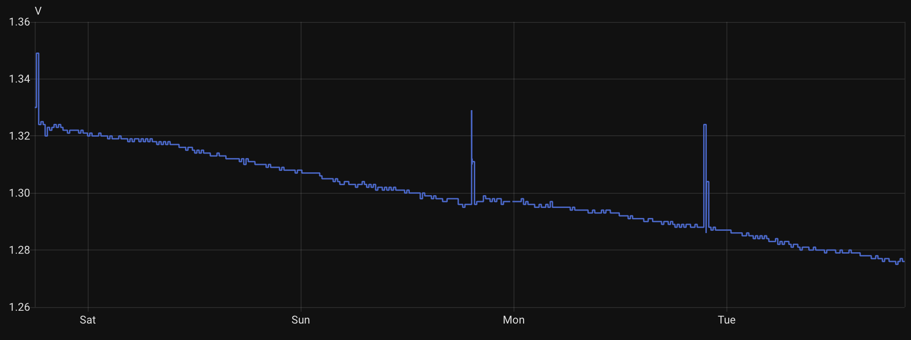

Intro stub: I rewrote the C++ firmware for the Seeed XIAO soil moisture kit in
Rust (`no_std`, embassy, esp-hal, rs-matter-embassy) —
[repo](https://github.com/jan-xyz/xiao-soil-moisture-sensor-matter-thread-rs).
This post is about how that firmware is put together and what it taught me
about sleepy Matter devices on the ESP32.

> Disclaimer: like the C++ original, this uses Matter test credentials
> (vendor ID `0xFFF1`, product ID `0x8010`) and is not CSA-certified.
> Ecosystems warn about an uncertified device during commissioning — expected.

# Why this project

- cover: the C++ original (automatous-io/xiao-soil-moisture-sensor-matter-thread) worked — why rewrite in Rust
- cover: state of esp-hal + embassy in 2026, `no_std` on the ESP32-C6
- cover: what "pragmatic MVP, not full parity" means (see Known limitations)

# The hardware

- cover: XIAO ESP32-C6 carrier kit: capacitive probe, 3 status LEDs, button, single AA cell
- cover: the thing that bites: boost converter pulls ~100 mA at 3.3 V from a 1.5 V cell

# Architecture: behaviour as data

- cover: the layering from ARCHITECTURE.md: composition root → decision/integration layers → ports → device vs host `sim`
- cover: pitch in one sentence: push everything physical to the outside, treat behaviour as data
- cover: workspace layout `core` / `node` / `fw` / `sim`; `sim` is host-only, `default-members = ["fw"]`
- cover: what becomes testable without hardware (sampling cadence, report thresholds, gestures)

# Matter on top

- cover: rs-matter-embassy `light_thread_coex` shape: MatterStack over EmbassyThreadNetwork, BLE-concurrent commissioning
- cover: hand-written clusters: `SoilMeasurement` (moisture %) and `PowerSource` (battery %, voltage, estimated time remaining)
- cover: battery estimate from resting voltage per boot, any AA chemistry; errs on the empty side near the end (docs/battery.md)

# Sleepy end devices: SIT vs LIT

- cover: three things all called "sleep" (Thread SED role / radio off / MCU sleep) — ivmarkov's icd.md table
- cover: deep sleep == LIT (idle > 15 s); light sleep on ESP is inefficient (35–180 µA vs 7 µA deep sleep) and only serves SIT
- cover: on wake a LIT device re-sends all subscribed attributes anyway (no dataver persistence) → no flash writes needed to suppress unchanged reports
- cover: controller support caveat: LIT needs a Check-In client; Google/Apple not yet (Matter 1.5 pending), Samsung beta, HA buggy → falls back to SIT; links to rs-matter-embassy#84 and the matteralpha article
- cover: the check-in race I hit in Home Assistant (check-in sent before Thread/SRP is up) — logs in #84
- cover: measured results: ~0.12 mA asleep vs ~100 mA awake, 6 h LIT interval → >1 year on one AA cell; rejected dynamic sleep intervals (discharge ~linear, keep it simple)
- cover: the ICD state machine lives in rs-matter core (project-chip/rs-matter#579), not in downstream crates; BLE powers down when idle or it eats the savings (esp-hal#6406, openthread#121/#122)

# Persistence and gestures

- cover: dry/wet calibration in its own flash partition, independent of Matter fabric persistence (factory reset ≠ recalibration)
- cover: button: single press = sample now, triple click = calibration flow, long hold = factory reset; also wakes from deep sleep
- cover: three LEDs: moisture classification, calibration feedback, error signals

# Build and flash traps

- cover: `rust-toolchain.toml`, `espflash.toml`, `partitions.csv`
- cover: what actually goes wrong on this platform (docs/building.md)

# Known limitations and what's next

- cover: no Matter OTA over Thread, no battery-sag/health measurement, no brownout diagnostics
- cover: LIT on controllers that don't implement it = SIT behaviour (short-idle polling, never deep-sleeps)
- cover: two fabrics is a trap (LIT as soon as either controller registers check-ins)
- cover: commands land at next wake-up (up to one idle period) — fine for a sensor, not for an actuator
- cover: idle period fixed at build time, on purpose
